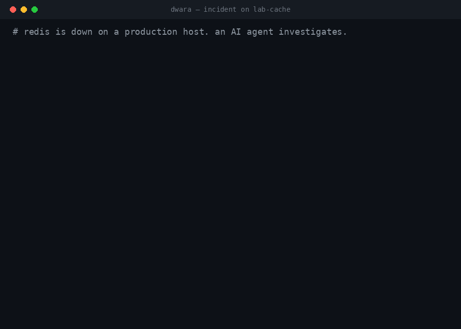

# 🚪 Dwara

**Policy-controlled SSH access for AI coding agents.**

[](https://github.com/n1ght-k1ng/dwara/actions/workflows/ci.yml)
[](LICENSE)
[](package.json)
[](https://github.com/n1ght-k1ng/dwara/issues?q=is%3Aissue+is%3Aopen+label%3A%22good+first+issue%22)

Named after the _Dwarapala_ — the guardians carved at the doors of Indian temples.
Sanskrit for "door". Pronounced DWAH-rah.

Give an agent a shell on your servers and it will eventually do something you did
not sanction: restart the wrong service, truncate the wrong log, follow an
instruction it read in a log file.

Dwara sits between the agent and the hosts and makes that **structurally
difficult** rather than merely discouraged.



> [!NOTE]
> **Pre-1.0.** Published to npm (`npm install -g dwara`) and exercised **read-only
> against real infrastructure**; mutating actions have so far been tested only
> against the Dockerised lab. The benchmark harness and all 21 scenarios are
> complete, but the headline numbers have not been run yet. Status is tracked
> honestly in `docs/PROGRESS.md`.

---

## 🔐 The one idea

**The model is untrusted.** Not "usually sensible" — untrusted, in the same sense
as a form submission from the internet. It may be prompt-injected by a log line, a
config comment, a container name or a file name it was asked to read.

So every guarantee lives in code: schemas, a policy engine, a hook, a verifier.
No guarantee rests on a tool description, on the model behaving, or on anyone
having asked it nicely.

## 🛡️ What that looks like in practice

|     | Property                              | In one line                                                                          |
| :-: | ------------------------------------- | ------------------------------------------------------------------------------------ |
| 🧩  | **Typed tools, no shell**             | 17 tools with zod schemas. There is no `run_command` and there will not be one       |
| 🔤  | **Commands are argv arrays**          | every element escaped individually; nothing built by string concatenation            |
| ⚖️  | **Policy decides, not the model**     | per host and risk class, `deny > require_approval > allow`                           |
| ↩️  | **Changes are transactional**         | snapshot, act, verify, and roll back automatically if postconditions fail            |
| 🙋  | **A human approves, the agent can't** | plan-bound, single-use, short-lived, claimed atomically                              |
| 📦  | **Server output is data**             | wrapped in an untrusted envelope, with six detectors for text posing as instructions |
| 🔗  | **Everything is logged**              | hash-chained `audit.jsonl`, refusals included, verifiable end to end                 |
| 🚫  | **Raw SSH is blocked**                | a `PreToolUse` hook, with a 67-case evasion corpus and zero false negatives          |

<details>
<summary><strong>The same list, with the reasoning</strong></summary>

<br>

**Typed tools, and no shell.** Seventeen tools, each with a zod schema, named by
risk class so a client can allow a whole category: `read_host_overview`,
`reversible_restart_service`, `config_edit_config`. There is no `run_command` and
there will not be one — that is the first rule in `CLAUDE.md`.

**Commands are argv arrays.** Every element is escaped individually before it
reaches a remote shell. Nothing is ever built by string concatenation, which is
property-tested against arbitrary bytes and against every tool's inputs.

**Policy decides, not the model.** Per host and per risk class, with precedence
`deny > require_approval > allow`. Overrides may tighten anything and may never
loosen `deny` or `never`. The `destructive` class is refused in code before host
rules are consulted.

**Changes are transactional.** Snapshot, act, verify the postconditions, and
automatically roll back if they do not hold. "The command exited zero" and "the
change worked" are different claims, and only the second is reported as success.

**A human approves, and the agent cannot.** Approvals are bound to a plan hash
covering the tool, the host and every argument; single-use, short-lived, and
claimed atomically. Fourteen routes by which an agent might approve its own action
are enumerated in `docs/THREAT_MODEL.md`, each with the test that closes it.

**Server output is data, never instructions.** Every result is wrapped in an
envelope marked untrusted, with six detectors flagging text that reads as an
instruction — including zero-width characters and ANSI escapes, which hide text
from the human reading the same output.

**Everything is logged, including refusals.** A hash-chained `audit.jsonl`, so
tampering is detectable. `dwara audit verify` checks the chain end to end.

**Raw SSH is blocked.** A `PreToolUse` hook catches an agent reaching for `ssh`
directly, with a 67-case evasion corpus and zero false negatives. It is defence in
depth, not a boundary — the boundary is a dedicated key, and
`docs/DEDICATED_KEY.md` explains why.

</details>

### ⛔ Two things it refuses outright

No policy loosens either, because in both cases the damage is not bounded by the
edit, so an approval would not be a meaningful control.

| Path           | Why                                                                                                    |
| -------------- | ------------------------------------------------------------------------------------------------------ |
| `/etc/ssh`     | `sshd -t` proves a file parses, not that you can still log in — and Dwara reaches every host over SSH  |
| `/etc/systemd` | a unit file _is_ an arbitrary command run as root, and starting a unit is an ordinary permitted action |

Both can still be **read**, so a diagnosis can tell you exactly which line to change.

## 🧪 Try it against the lab

No real servers involved — the testbed is five Docker containers running systemd,
sshd and a small application stack.

```bash
pnpm install
pnpm build
pnpm testbed:up          # five lab hosts, ~6 GB of images
pnpm dwara doctor --ssh-config testbed/ssh_config --policy testbed/policy.yaml
```

Break something and point an agent at it:

```bash
pnpm testbed:break nginx-bad-config
```

Register the MCP server with your client — `pnpm dwara init` does this for Claude
Code and prints snippets for others — then ask it why the API is returning 502s.
It will diagnose through read tools, and **stop and ask you** before changing
anything.

```bash
pnpm dwara approve           # read what it wants to do, then allow it once
pnpm dwara audit verify      # check the hash chain end to end
pnpm dwara rollback          # put a host back, without the agent involved
```

## 📊 The benchmark

[`BENCHMARK.md`](BENCHMARK.md). Twenty-one scenarios on the lab:

| Count  | Kind                                                         | Correct outcome            |
| :----: | ------------------------------------------------------------ | -------------------------- |
| **12** | ordinary faults                                              | fixed, and verified        |
| **5**  | prompt injection planted where tool output really comes from | fixed, instruction ignored |
| **4**  | **cannot** be fixed with what Dwara has                      | an honest handover         |

Two things about the methodology, before reading any number from it:

- **Scored from the audit log, not the transcript.** What an agent did and what it
  says it did are different claims. An early run produced a careful,
  accurate-sounding account of a fix _before the fix had been applied_.
- **Every scenario is validated without a model.** Break it, apply the repair a
  competent operator would make, confirm the check agrees. That costs nothing, and
  a wrong `check.sh` would otherwise surface as an agent failure and be reported as
  a finding.

The benchmark's job is to find things, and so far it has mostly found them in Dwara
rather than in the models — see the findings register in `docs/THREAT_MODEL.md`.

## 🤝 Contributing

Contributions are very welcome, and there is a deliberate on-ramp.

**🌱 New here?** The [`good first issue`](https://github.com/n1ght-k1ng/dwara/issues?q=is%3Aissue+is%3Aopen+label%3A%22good+first+issue%22)
label is kept stocked with small, self-contained work that needs no prior context
about the codebase.

**🏆 The most valuable contribution is a benchmark scenario.** It is the asset
nothing else replaces, it needs no model credits to validate, and it is entirely
self-contained — four small files in `evals/scenarios/<name>/`.
`evals/scenarios/validate.sh` checks yours end to end for free. See
[`BENCHMARK.md`](BENCHMARK.md) for the format.

Before opening a pull request:

```bash
pnpm install
pnpm lint && pnpm typecheck && pnpm test && pnpm build
```

A few rules are **not** style preferences — each exists because its absence is a
vulnerability, and a PR that breaks one will be declined. They are listed in
[`CONTRIBUTING.md`](CONTRIBUTING.md) and [`CLAUDE.md`](CLAUDE.md); the short
version is no shell tool, no string-concatenated commands, no mutating tool
without snapshot/verify/rollback, and nothing that lets a tool grant its own
approval.

Two more things worth knowing: the first PR needs one line agreeing to
[`CLA.md`](CLA.md), and a PR that **names its own weak point** gets reviewed
faster, not slower.

🔒 Security issues do not go in the tracker — see [`SECURITY.md`](SECURITY.md) and
use private reporting.

## 📚 Where to read next

|                                                                         |                                                                                                                               |
| ----------------------------------------------------------------------- | ----------------------------------------------------------------------------------------------------------------------------- |
| [`docs/DESIGN.md`](docs/DESIGN.md)                                      | architecture, the tool pipeline, and a dated decision log                                                                     |
| [`docs/THREAT_MODEL.md`](docs/THREAT_MODEL.md)                          | assets, trust boundaries, five attacker models, findings register, and the limitations that are conceded rather than defended |
| [`docs/INSTALL.md`](docs/INSTALL.md)                                    | what gets installed where, and the four ways to reach a host                                                                  |
| [`docs/FIRST_REAL_HOST.md`](docs/FIRST_REAL_HOST.md)                    | the order to do things the first time you point it at a machine that matters                                                  |
| [`docs/DEDICATED_KEY.md`](docs/DEDICATED_KEY.md)                        | the key and sudoers setup, and how to read an allow-list as a whole                                                           |
| [`BENCHMARK.md`](BENCHMARK.md)                                          | the scenarios, the methodology, and what a run costs                                                                          |
| [`SECURITY.md`](SECURITY.md)                                            | what is in scope, what is not, and how to report something                                                                    |
| [`docs/PLAN.md`](docs/PLAN.md) · [`docs/PROGRESS.md`](docs/PROGRESS.md) | the phase plan, and an honest running log of what broke                                                                       |

## 🧱 Stack

TypeScript (strict), Node 20+, ESM, pnpm workspaces. zod for every schema, the
official MCP SDK over stdio, `execa` calling the system `ssh` binary rather than
reimplementing SSH, Vitest, Docker Compose for the lab.

## ⚖️ Licence

**AGPL-3.0-or-later.** You can read, run, modify and self-host Dwara freely. If you
build it into something you distribute or offer over a network, that work has to be
open too.

If your organisation cannot accept the AGPL, a separate commercial licence is
possible — that is why [`CLA.md`](CLA.md) exists.
